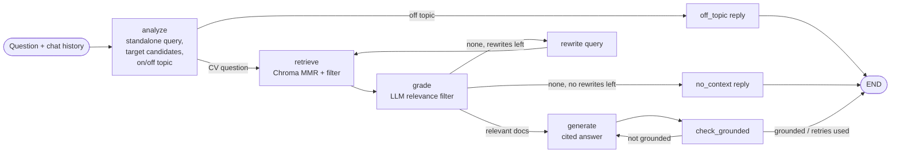

# 📄 CV RAG Assistant

Ask natural-language questions about a collection of CVs/résumés — *"Who has worked with CDC?"*,
*"Compare the candidates' education"*, *"Summarise Priya's last two roles"* — and get answers
grounded in the documents, with citations.

Built with **OpenAI** (chat + `text-embedding-3-large`), **LangGraph** (a self-correcting RAG
pipeline), **Chroma** (local, persistent vector DB) and **Streamlit** (UI), plus an
**evaluation suite** for retrieval and answer quality.

---

## Features

- **Upload CVs** in PDF, DOCX, TXT or Markdown from the UI or the CLI.
- **CV-aware chunking** — splits by section (Experience, Education, Skills…) and prefixes every
  chunk with `Candidate: <name> | Section: <section>`, so retrieved snippets never lose track of
  whose CV they came from.
- **Candidate-aware retrieval** — names mentioned in the question (or chosen in the sidebar)
  become a metadata filter; MMR search keeps results diverse across CVs.
- **Corrective RAG with LangGraph** — query rewriting with chat history, relevance grading,
  automatic query re-writing when nothing relevant is found, and a groundedness check that
  regenerates hallucinated answers.
- **Citations & trace** — each answer shows its source chunks and, optionally, the pipeline steps.
- **Evaluation** — retrieval metrics (hit rate, MRR, candidate recall/precision) and
  LLM-as-judge scores (correctness, faithfulness, relevance), reported in Markdown and JSON.

## Architecture

Full system diagram (indexing, question answering, evaluation): [docs/architecture.md](docs/architecture.md).



Ingestion: `file → text (pypdf / python-docx) → sections → chunks + metadata → OpenAI embeddings → Chroma (./chroma_db)`.

## Project structure

```
cv-rag-assistant/
├── app/
│   └── streamlit_app.py          # Streamlit UI
├── src/cv_rag/
│   ├── config.py                 # settings from env / .env
│   ├── loaders.py                # PDF / DOCX / TXT / MD → text
│   ├── chunking.py               # section-aware chunking, candidate detection
│   ├── vectorstore.py            # Chroma + OpenAI embeddings wrapper
│   ├── prompts.py                # all prompt templates
│   ├── graph.py                  # LangGraph RAG pipeline
│   └── evaluation/
│       ├── metrics.py            # deterministic retrieval/answer metrics
│       ├── judge.py              # LLM-as-judge
│       └── runner.py             # runs dataset, writes reports
├── scripts/
│   ├── ingest.py                 # CLI: index CVs
│   └── evaluate.py               # CLI: run evaluation
├── evaluation/
│   ├── datasets/cv_eval.jsonl    # labelled questions for the sample CVs
│   └── results/                  # generated reports (git-ignored)
├── data/sample_cvs/              # 3 fictional CVs to try the app
├── tests/                        # unit tests (no API key needed)
├── .github/workflows/ci.yml      # lint + tests (+ optional eval)
├── .env.example
├── Makefile
├── pyproject.toml
└── requirements.txt
```

## Quick start

**Prerequisites:** Python 3.10+ and an OpenAI API key.

```bash
git clone https://github.com/<your-username>/cv-rag-assistant.git
cd cv-rag-assistant

python -m venv .venv
source .venv/bin/activate          # Windows: .venv\Scripts\activate
pip install -r requirements.txt

cp .env.example .env               # then set OPENAI_API_KEY in .env

python scripts/ingest.py data/sample_cvs   # optional: index the sample CVs
streamlit run app/streamlit_app.py
```

Open http://localhost:8501, upload CVs from the sidebar (or use the samples) and start asking.

With `make`: `make install`, `make ingest`, `make run`, `make eval`, `make test`.

### Example questions (sample CVs)

- Which candidate has experience building a RAG system?
- Who has worked with change data capture?
- Compare the education of all three candidates.
- Who is the best fit for an AWS streaming data platform role, and why?
- *(follow-up)* What certifications does she have?

## Configuration

All settings live in `.env` (see `.env.example`):

| Variable | Default | Notes |
|---|---|---|
| `OPENAI_API_KEY` | — | Required |
| `OPENAI_CHAT_MODEL` | `gpt-4o-mini` | Any chat model that supports structured output |
| `OPENAI_JUDGE_MODEL` | `gpt-4o` | Used only by the evaluator; a stronger model than the chat model is recommended |
| `OPENAI_EMBEDDING_MODEL` | `text-embedding-3-large` | OpenAI's strongest embedding model (3072 dims) |
| `OPENAI_EMBEDDING_DIMENSIONS` | *(full)* | e.g. `1024` to shrink vectors with little quality loss |
| `CHROMA_PERSIST_DIR` | `./chroma_db` | Local vector DB folder |
| `CHUNK_SIZE` / `CHUNK_OVERLAP` | `800` / `120` | Characters |
| `RETRIEVAL_TOP_K` / `RETRIEVAL_FETCH_K` | `6` / `20` | Final chunks / MMR candidate pool |
| `MAX_QUERY_REWRITES` | `1` | Retries when no relevant chunks are found |
| `MAX_GENERATION_RETRIES` | `1` | Regenerations when the answer isn't grounded |

> **Changing the embedding model or dimensions?** Re-index: `python scripts/ingest.py data/sample_cvs --reset`
> (vectors of different sizes can't share a collection).

## Evaluation

```bash
python scripts/evaluate.py              # full run: retrieval metrics + LLM-as-judge
python scripts/evaluate.py --no-judge   # cheaper: deterministic metrics only
python scripts/evaluate.py --fail-under 4.0   # exit 1 if mean correctness < 4 (CI gate)
```

The evaluator indexes the CVs into a **separate collection** (`cvs_eval`), so your real index is
untouched. It runs every question in `evaluation/datasets/cv_eval.jsonl` through the full graph and
writes `evaluation/results/eval_<timestamp>.{md,json}` plus `latest.md`.

| Metric | Type | What it measures |
|---|---|---|
| `retrieval_hit` | retrieval | A chunk from the right candidate containing an expected keyword was retrieved |
| `retrieval_mrr` | retrieval | 1 / rank of the first such chunk |
| `candidate_recall` | retrieval | Share of expected candidates that appear in retrieved chunks |
| `candidate_precision` | retrieval | Share of retrieved chunks from the expected candidates |
| `context_keyword_recall` | retrieval | Expected keywords present in retrieved context |
| `answer_keyword_recall` | generation | Expected keywords present in the answer |
| `correctness` | LLM judge (1–5) | Agreement with the reference answer; rewards abstaining on unanswerable questions |
| `faithfulness` | LLM judge (1–5) | Every claim supported by retrieved context (hallucination check) |
| `relevance` | LLM judge (1–5) | Answer addresses the question |
| `latency_s` | ops | End-to-end seconds per question |

The dataset covers six categories — `single_fact`, `search`, `multi_candidate`, `comparison`,
`unanswerable` and `off_topic` — and the report breaks scores down by category.

**Adding your own test set:** create a JSONL file with one object per line:

```json
{"id": "x1", "category": "single_fact", "question": "...", "reference_answer": "...",
 "expected_candidates": ["Full Name"], "expected_keywords": ["term that must appear"]}
```

then run `python scripts/evaluate.py --dataset path/to/file.jsonl --cv-dir path/to/cvs`.

## Tests

```bash
pip install -r requirements-dev.txt
pytest -q
```

Unit tests cover parsing, chunking, candidate detection, metrics and every graph route (using a
scripted fake LLM), so they run offline and free.

## Privacy note

CVs contain personal data. Chunks are stored locally in `chroma_db/`, but text is sent to the
OpenAI API for embedding and answering. Make sure you have the right to process the CVs you upload.
`.gitignore` excludes `.env`, `chroma_db/` and everything in `data/` except the fictional samples —
don't commit real CVs.

## Roadmap ideas

- Hybrid search (BM25 + vectors) for exact skill/keyword matches
- Cross-encoder re-ranking
- Streaming responses in the UI
- Structured candidate profiles (years of experience, skills) extracted at ingest for filtering
- Docker image / Streamlit Community Cloud deployment
