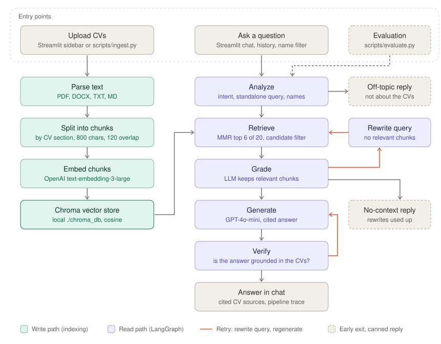
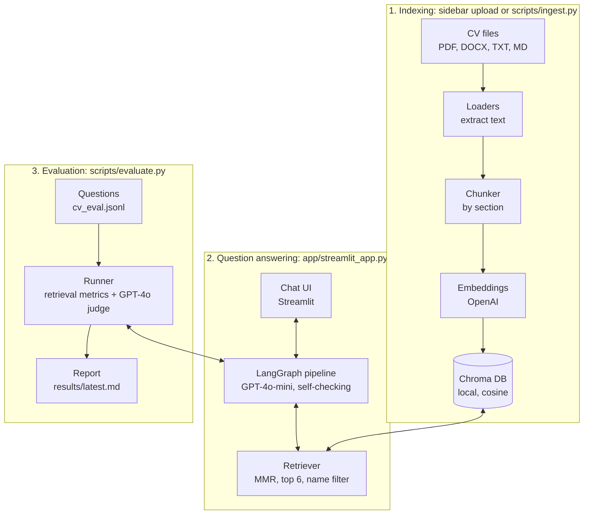
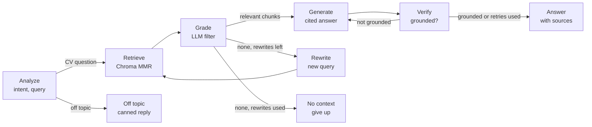

# Architecture

The Streamlit UI starts two paths. The write path (left) parses, chunks and embeds CVs into Chroma. The read path (right) is the LangGraph pipeline in `src/cv_rag/graph.py`. Off-topic questions exit after Analyze, and if no relevant chunks survive a rewrite, the pipeline replies that it found no context. Retry limits are set by `MAX_QUERY_REWRITES` and `MAX_GENERATION_RETRIES` (both default to 1).

## System overview

## LangGraph pipeline (`src/cv_rag/graph.py`)

Retry limits are set by `MAX_QUERY_REWRITES` and `MAX_GENERATION_RETRIES` (both default to 1).
